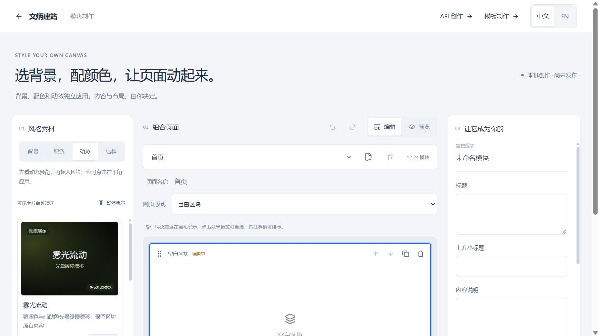

# Wenbing Builder

A self-hosted website builder with one-click website creation, visual block editing, and optional OpenAI-compatible generation. Start with a complete set of pages, then customize their content, backgrounds, colors, and effects.

No account is required. Drafts live in the browser. The API and guided-template workflows also provide HTML downloads that you can host yourself.

## New: One-click website creation

**Create a 1–10-page website in one click, then edit every page in the same continuous canvas.**

In the block editor, choose **Entire site**, enter a **Page count** from 1 to 10, and click **Generate site**. Empty and newly added pages receive editable sections and navigation; existing content is preserved on pages that remain. Reducing the count removes the trailing pages, and one undo restores the previous project.

- **Ready-to-edit pages** — generate layouts, backgrounds, and effects without an API key. All pages appear vertically in the existing canvas.
- **Flexible colors** — by default, generated blocks share base colors and use varied effect accents. Turn on **Unified colors** to reveal presets and color pickers that update the site immediately.
- **Continuous editing** — drag materials onto individual blocks, adjust content, and use undo/redo. Unified colors also apply to newly added blocks.
- **Local persistence** — save the color mode and project in your browser, with protection against conflicting saves from other tabs.

See the [update notes](CHANGELOG.md) for this release's features and bug fixes.



*Earlier editor view; the new generation and color controls are described above.*

## Blocks

Background surfaces, navigation, hero, text, image cards, accordion lists, action sections, and large signature text. Drop one on the canvas and click to edit it. Drag to reorder within a page, undo when you change your mind.

## Effects that stay on their block

Cursor glow, scroll reveal, image zoom, star drift, video backgrounds. Each one attaches to a block instead of the whole page, so adding a second effect doesn't overwrite the first. All of them back off when the system asks for reduced motion.

## Your model, your key

Any HTTPS endpoint that speaks `chat/completions`. The key lives in page memory, travels through the server to your endpoint, and is never written to the database. Costs and limits are whatever your provider charges.

Generated HTML can be downloaded or sent to the block editor as an isolated static HTML block. Add native blocks around it to extend the page.

## Chinese and English

The interface switches language; the content you wrote stays as you wrote it.

## Deploy where you want

A Docker Compose file with Caddy handling TLS, or the Render blueprint if you just want to see it running.

## Running it locally

Node 24.19 or newer, within the 24.x line.

```sh
git clone https://github.com/JOE-D-MAX/wenbing-builder.git
cd wenbing-builder
npm ci
npm run dev -- --hostname 127.0.0.1 --port 3000
```

Open <http://127.0.0.1:3000>.

| Path | Purpose |
| --- | --- |
| `/` | landing page |
| `/studio` | pick a workflow |
| `/studio/blocks` | block editor |
| `/studio/api` | generate from a prompt |
| `/studio/manual` | template-guided |

## Deploying

The Render button gives you a free preview in a couple of clicks. The instance sleeps when idle and its disk is wiped on restart, so treat it as a demo.

For a real deployment you need a Linux machine with Docker, a domain pointing at it, and ports 80 and 443 open:

```sh
cp deploy/env.example deploy/.env
# set DOMAIN and TLS_EMAIL
docker compose --env-file deploy/.env -f deploy/compose.yaml up -d --build
```

[deploy/README.md](deploy/README.md) covers health checks, backups and the Caddy configuration. There is no checkout or account system: you download the HTML and host it wherever you like.

## Checks

```sh
npm run typecheck
npm test
npm run test:i18n
npm run build
```

The build produces `dist/standalone`, which is what the Docker image runs.

## Layout

```text
app/                 routes and API handlers
components/studio/   the editors
lib/                 block model, renderer, generation, storage, i18n
deploy/              Docker, Caddy, backup configuration
scripts/             build helpers and tests
vendor/              third-party sources, notices and licenses
```

## Credits

Built on React, Next, Vite (through vinext), dnd-kit, Radix, i18next and Drizzle. The prompt guidance in the API workflow is adapted from UI/UX Pro Max and Design Taste Frontend; their notices and license texts are kept under [vendor](vendor/).

Portfolio blocks ship as generic placeholders. No personal site content or archived media is bundled with this repository.

## License

GNU AGPL-3.0. Copyright (C) 2026 JOE-D-MAX.

Use it, modify it, self-host it. If you run a modified version as a network service, the AGPL requires you to publish your changes under the same license.
